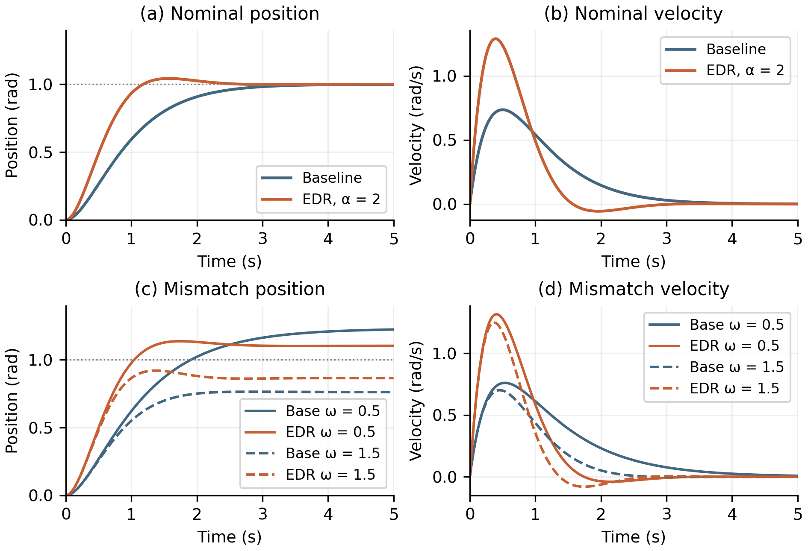

# EDR replication and validation

Code and evidence for reproducing the linear pendulum example in Fangyuan Li's
2026 paper, *Equilibrium Drift Restriction: A Control Strategy for Reducing
Steady-State Error Under System Inconsistency*.

## Start here

- [Project reproduction and validation code](reproduce.py)
- [Download the checkpoint 2 code and evidence ZIP](downloads/EDR_Checkpoint_2_Code_and_Evidence.zip)
- [Six-case numerical results](evidence/metrics.csv)
- [Run metadata and validation checks](evidence/verification.json)
- [Detailed file guide](README.txt)

The saved experiment ran on 17 October 2026. A run from the extracted package
on 27 October 2026 reproduced the metrics, alpha-sweep summaries and published
curve comparisons exactly in the existing Python environment. Installation in
a fresh environment remains to be checked.

## What the project adds

`source/author_experiment1.py` is the author's original simulation, preserved
unchanged. `reproduce.py` is the project-added wrapper. It runs that simulation,
exports and reloads the trajectories, checks them against a separate DOP853
integration and closed-form solutions, compares published PDF curves, and
evaluates four values of the EDR parameter.

The [author's source repository](https://github.com/fylimas/EDR) and the
[published paper](https://doi.org/10.3390/mca31010011) are source references.
The wrapper, exported results and validation records can be inspected here.

## Reproduce the results

Use Python 3.12. From the repository root or extracted evidence folder, run:

```sh
python -m pip install -r requirements.txt
python reproduce.py
```

The pinned dependencies are in `requirements.txt`. No external dataset,
training or random seed is required. The script overwrites generated files
under `evidence/`; use a copy to retain the supplied outputs. The original
source files remain unchanged.

Expected outputs are six main cases, 6000 finite trajectory rows, six original
author figures, 12 alpha-sweep cases and comparisons at 715 drawing vertices
from 12 published curves. Assertions check the numerical differences and data
export/reload. The original plot-label escapes can produce harmless
`SyntaxWarning` messages on Python 3.12; these are recorded in the run log.

## Replicated outputs



The main runs use a 1 rad reference, zero initial states, 1000 output times
from 0 to 5 s, frequencies 0.5, 1.0 and 1.5 rad/s, and alpha values 0 and 2.

| Frequency (rad/s) | Baseline steady error | EDR steady error |
| --- | ---: | ---: |
| 0.5 | 23.08% | 10.34% |
| 1.0 | 0.00% | 0.00% |
| 1.5 | 23.81% | 13.51% |

Steady errors use analytical equilibria and are distinct from the 5 s
endpoints. The worst error decreases by 43.24% relative to baseline. Sampled
peak input increases from 4 to 8 model units, and nominal overshoot increases
from 0% to 4.32%.

## Evidence map

| Result | Files |
| --- | --- |
| Main replicated figure | `evidence/replicated_figures_2_3.png`, `evidence/trajectories.csv` |
| Six-case results and independent checks | `evidence/metrics.csv`, `evidence/verification.json` |
| Published figure comparison | `evidence/published_vector_points.csv`, `evidence/published_figure_comparison.csv` |
| Parameter variation | `evidence/alpha_sweep.csv`, `evidence/alpha_sweep_trajectories.csv`, `evidence/alpha_tradeoff.png` |
| Original simulation outputs | `evidence/author_figures/` |
| Console output | `evidence/run_log.txt` |

The published comparison uses PDF drawing vertices against the closed-form
solution at their extracted times. It does not provide the author's original
raw samples or physical experimental accuracy. The model is linear and
unsaturated; hardware, noise, delays, Q-learning and MIMO results are outside
this replication.

## Sources

F. Li (2026), *Mathematical and Computational Applications*, 31(1), 11.
DOI: [10.3390/mca31010011](https://doi.org/10.3390/mca31010011).

The included paper is distributed under CC BY 4.0. The original simulation
retains its attribution to the author and its original source terms.
