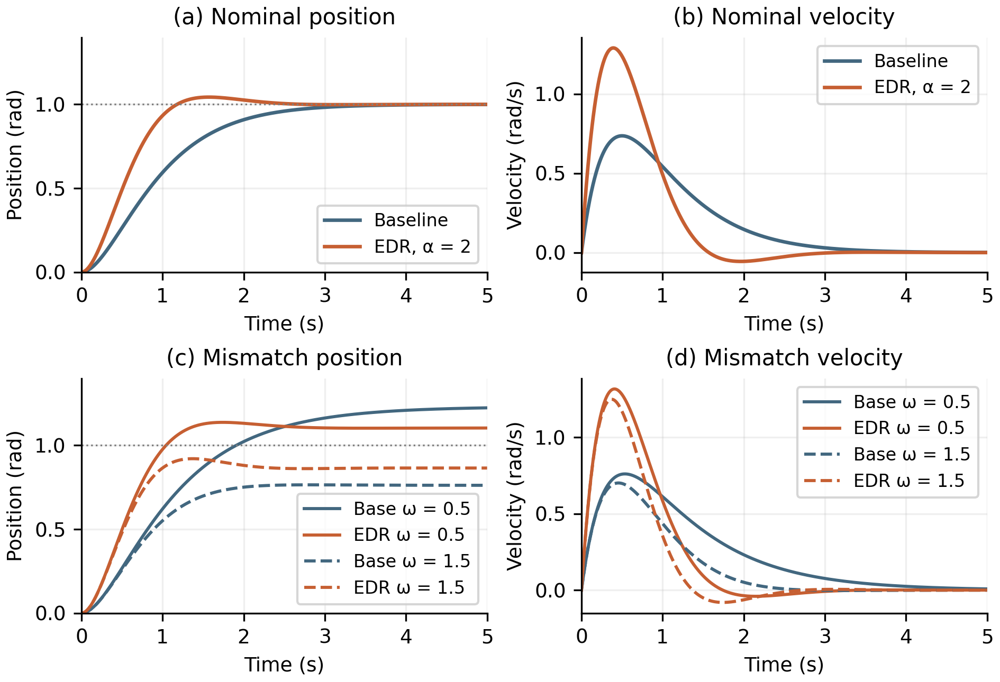

# EDR reproduction and equation-based reconstruction

**Group Ctrl_4 | EEEN3015J Control Theory | Final report, Section A**

This project studies the linear pendulum example in Fangyuan Li's 2026 paper
*Equilibrium Drift Restriction: A Control Strategy for Reducing Steady-State
Error Under System Inconsistency*. It separates author-code re-execution,
equation-based modelling and published-graphic comparisons.

## Start here

- [Primary equation-based implementation](replication/independent_model.py)
- [Independent trajectories and verification](evidence/independent/)
- [Post-generation comparisons](evidence/comparison/)
- [Final Section A code and evidence ZIP](downloads/EDR_Section_A_Code_and_Evidence.zip)
- [Original author source](author_source/)

## Evidence provenance

| Route | Code and inputs | What it establishes |
| --- | --- | --- |
| A: author re-execution | [Author rerun wrapper](replication/author_rerun.py) executes the original script. [Sensitivity audit](replication/author_sensitivity_audit.py) executes the original Figure 7 script. | Reproducibility of the supplied software and its outputs. |
| B: standalone model | [Independent model](replication/independent_model.py) implements the plant and controller equations. It reads no author scripts, PDFs or existing comparison results. | Computational reconstruction and numerical verification of the stated model. |
| C: graphic audit | PDF vector coordinates saved in the comparison evidence. | Consistency with the published drawing, not an independent dataset. |

A and C share the author's computational lineage. Very small differences
between them are expected and are not presented as independent replication.
B was developed after access to the paper and source. Its independence is in
its executable implementation and calculation, not a blinded development
process or new physical experiment. Model assumptions and settings remain shared.

## Run the primary model

Use Python 3.12 from the repository root:

```sh
python -m pip install -r requirements.txt
python reproduce.py
```

The default entry point runs **B only**. It writes to `evidence/independent/`,
leaving the archived A/C reference outputs separate. The model can also run alone:

```sh
python replication/independent_model.py --output-dir my_results
```

The script computes controller input and plant derivative separately, integrates
with DOP853, and exports its own trajectories, metrics and plots. It covers six
main cases, twelve gain-variation cases and 200 Figure 7 endpoint calculations.
Checks cover an analytical solution, RK45 agreement, tighter solver tolerances
and two cases with changed references and nonzero initial states.

On 2 November 2026, B ran in a separate directory containing only the project
launcher/model scripts and numerical-library dependencies. Author files, PDF and saved reference
outputs were absent. Its checks passed the numerical target of 1e-6. The environment
and results are in the [independent verification record](evidence/independent/verification.json).

The default entry-point isolation check is repeatable with
`python replication/verify_standalone_execution.py`; it creates a temporary
directory containing only the launcher and model, runs there, and compares
outputs after the isolated process exits. See the
[execution check record](evidence/independent/execution_check.json).

## Compare after model generation

```sh
python replication/compare_evidence.py
python replication/overlay_published_curves.py
python replication/design_analysis.py
```

The comparison script reads completed B results and archived A/C outputs.
It does not change parameters or execute author code. The design analysis
evaluates explicitly illustrative error, overshoot and input targets.

The post-hoc overlay evaluates the saved B states with cubic Hermite interpolation
at the PDF vertex times. It keeps position residuals in radians and velocity
residuals in radians/second. It does not fit the model to the publication.
The overlay, 12 curve-level residuals and 715 vertex comparisons are available
under `evidence/comparison/`. The timed isolated run on 3 November 2026 took
about 17.9 seconds including numerical checks and plotting, on the environment
recorded in `evidence/independent/execution_check.json`.

Inspect the [published-curve overlay](evidence/comparison/published_overlay.png)
and the [curve-level residual table](evidence/comparison/curve_residuals.csv).

The report's code/data version is [section-a-2026-11-03](https://github.com/ohhhhhhhhha/edr-replication/tree/section-a-2026-11-03).

To rerun the original-author routes separately:

```sh
python replication/author_rerun.py
python replication/author_sensitivity_audit.py
```

These commands execute the author implementation and regenerate A/C artifacts.
They are not required to generate B results.

## Main results from B



The model uses a 1 rad reference, zero initial states, 1000 output times from
0 to 5 s, frequencies 0.5, 1.0 and 1.5 rad/s, and alpha values 0 and 2.
Analytical equilibria, corroborated by B, give the following steady errors:

| Frequency (rad/s) | Baseline | EDR, alpha = 2 |
| --- | ---: | ---: |
| 0.5 | 23.08% | 10.34% |
| 1.0 | 0.00% | 0.00% |
| 1.5 | 23.81% | 13.51% |

The gain variation quantifies the tradeoff with nominal overshoot and input.
The Figure 7 calculation distinguishes the 5 s endpoint-frequency spread from
the true equilibrium spread and worst reference error. The report labels the
independent model outputs and original-code/drawing comparisons separately.

## Files and ownership

- `replication/independent_model.py`: primary project equation implementation.
- `replication/compare_evidence.py`: separate A/B/C comparison stage.
- `replication/overlay_published_curves.py`: post-hoc overlay and unit-specific residuals.
- `replication/author_rerun.py`, `replication/author_sensitivity_audit.py`: project wrappers for original-author execution and graphic audits.
- `replication/design_analysis.py`: analytical design extension.
- `author_source/`: unchanged author scripts and published paper.
- `evidence/independent/`: B outputs and numerical checks.
- `evidence/comparison/`: explicitly labelled cross-source results.
- Files directly under `evidence/`: archived author-route, graphic-audit and earlier extension outputs.

## Sources

F. Li (2026), *Mathematical and Computational Applications*, 31(1), 11.
[Paper DOI](https://doi.org/10.3390/mca31010011) |
[Author repository](https://github.com/fylimas/EDR).

The included paper is CC BY 4.0. Original scripts retain the author's attribution
and source terms. The checkpoint 2 archive is retained as an
[earlier snapshot](downloads/EDR_Checkpoint_2_Code_and_Evidence.zip).
